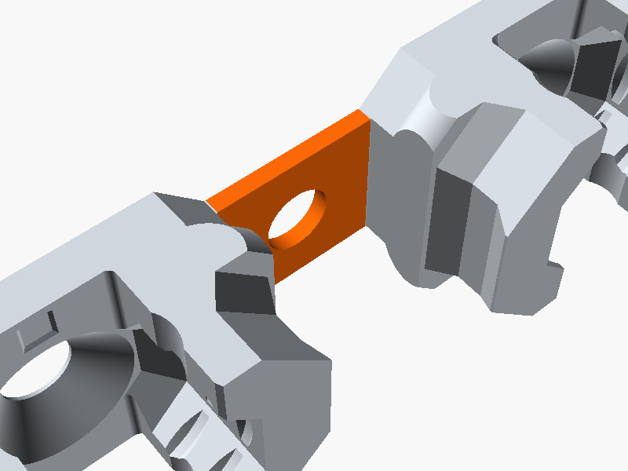
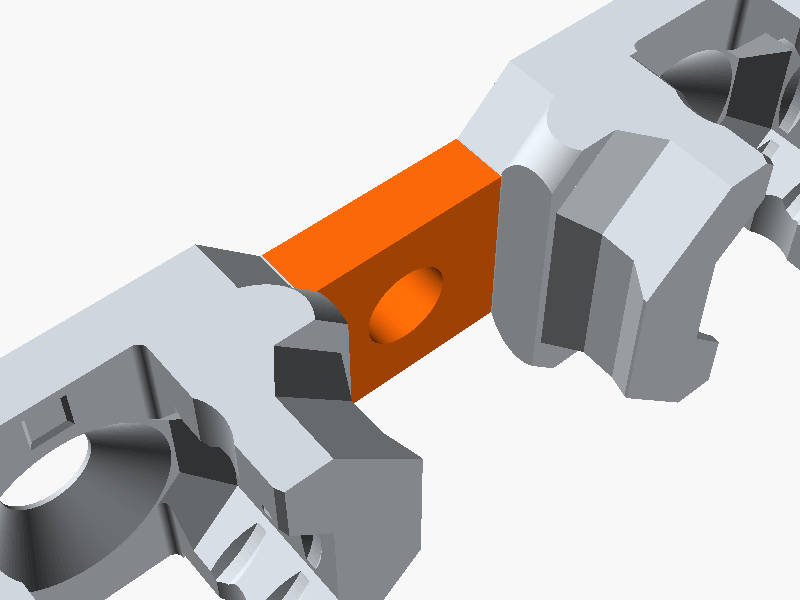
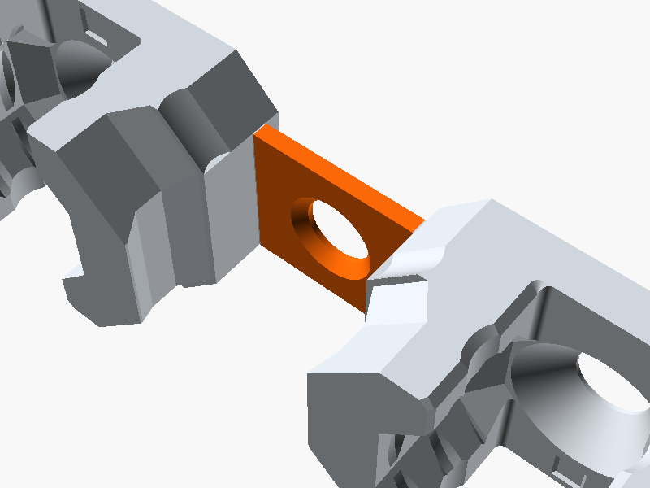
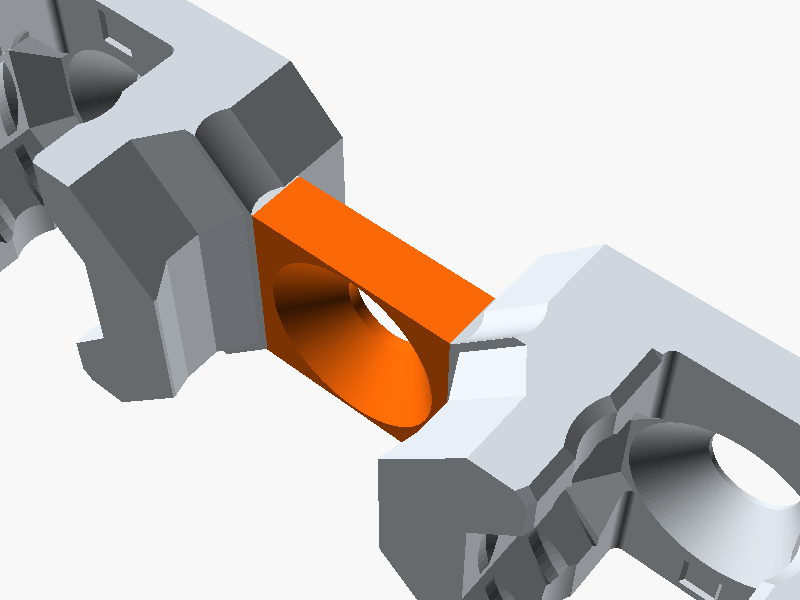
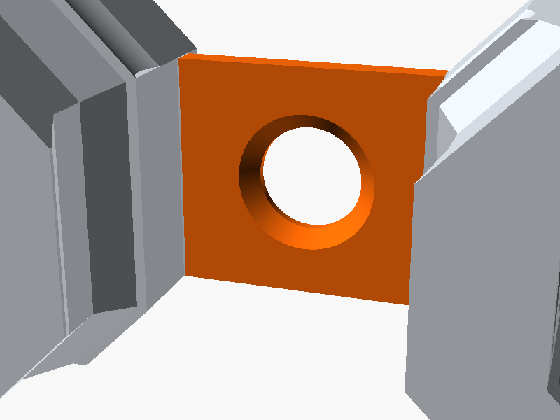
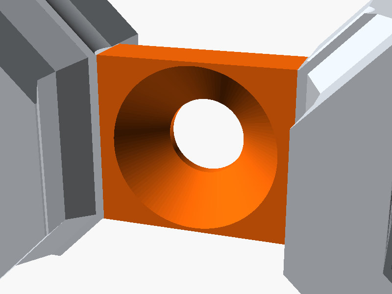
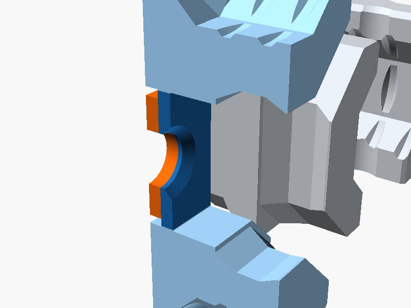
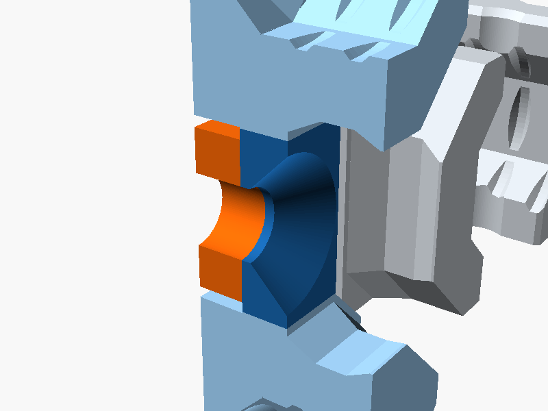

# multiboard-remixes

Parametric OpenSCAD remixes of [Multiboard](https://www.multiboard.io/) parts.

## Quad Offset Snaps, 6.25 mm

[`quad-offset-snaps/`](quad-offset-snaps/) remixes MultiBuild's
*6.25 mm - Quad Offset Snaps (DS Part A)*
([Thangs](https://thangs.com/designer/MultiBuild/3d-model/6.25%20mm%20-%20Quad%20Offset%20Snaps%20%28DS%20Part%20A%29-993369),
[multibuild.io](https://multibuild.io/search?query=6.25%20quad%20offset)):
two parts, each a pair of snaps joined by a bridge. Part 2 crosses Part 1 at
90° and its bridge sits on Part 1's.

In the downloadable model the bridges are 1.125 mm thick, which differs from
the listing's photos. This remix makes both bridges 3.125 mm thick for a
sturdier joint, and moves Part 2's bridge up to keep sitting on Part 1's. The
snaps themselves are unchanged.

| | Original | Remix |
| --- | --- | --- |
| **Part 1 bridge** | <br>1.125 mm thick, 0 – 1.125 mm from the back face | <br>**3.125 mm** thick, 0 – 3.125 mm from the back face |
| **Part 2 bridge** | <br>1.125 mm thick, 1.125 – 2.25 mm from the back face | <br>**3.125 mm** thick, **3.125 – 6.25 mm** from the back face |
| **Part 2 bridge hole** | <br>45° countersink 0.725 mm deep, Ø 4.5 → 5.95 mm | <br>45° countersink **2.5 mm** deep, Ø 4.5 → **9.5 mm**, the same as the snaps' holes |
| **Stacked**, cut through the middle | <br>Part 2's bridge (blue) on Part 1's (orange) | <br>Same stack, both bridges thicker |

### STLs

Ready to print, in [`quad-offset-snaps/stl/`](quad-offset-snaps/stl/):

- [`quad-offset-snaps-part1.stl`](quad-offset-snaps/stl/quad-offset-snaps-part1.stl)
- [`quad-offset-snaps-part2.stl`](quad-offset-snaps/stl/quad-offset-snaps-part2.stl)

## Build

```
task                              # render every STL
task quad-offset-snaps:part PART=2   # one part
```

Or open `quad-offset-snaps/quad-offset-snaps.scad` and set `part = 1` or `2`.

Needs [OpenSCAD](https://openscad.org/) and, for `task`,
[Task](https://taskfile.dev/).

## Licence

These are remixes of [Multiboard](https://www.multiboard.io/) designs by
[Keep Making](https://thangs.com/designer/Keep%20Making), made and shared
under the Multiboard Licence (12 June 2024). They carry the same terms:
personal, non-commercial use only. See [LICENSE](LICENSE).
